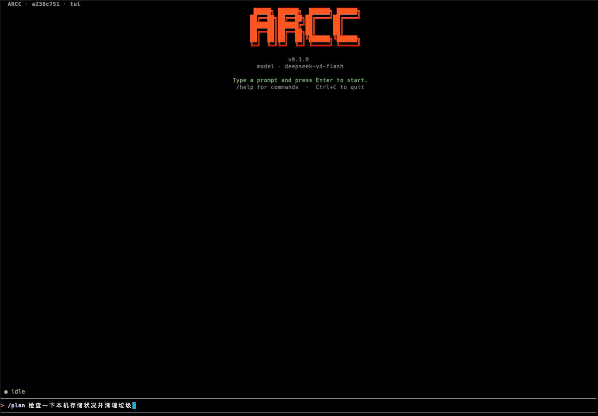

# ARCC

**[ARCC](https://juejin.cn/post/7650384140925812751) (A Rust Copilot CLI)** — a local-first terminal AI agent written in Rust. Runs as TUI, CLI, Server, or ACP stdio, speaks MCP & ACP, and connects to DeepSeek / Claude / OpenAI.  
Rust 实现的终端 AI Agent，支持 CLI、TUI、Server、ACP 四种运行模式，兼容 MCP、ACP 协议。

[](https://www.rust-lang.org)
[](https://deepseek.com)
[](https://modelcontextprotocol.io)
[](https://github.com/nicepkg/acp)
[](https://github.com/niyongsheng/arcc/actions/workflows/ci.yml)
[](https://github.com/niyongsheng/arcc/releases)



## Features

- **🤖 Dual-Model Scheduling** — DeepSeek-V4-Pro for complex reasoning, DeepSeek-V4-Flash for routine chat; context auto-compressed at ~800k tokens.
- **🔌 MCP & ACP** — Native MCP client for plugin tools; ACP v1 stdio server (`arcc --acp`) for GUI agents like AionUI.
- **🛡️ Safety Engine** — Command allowlist → risk rating → interactive confirmation (y/a/n) for dangerous operations.
- **💾 Local-First Persistence** — SQLite for sessions/messages/tokens, JSON Lines for audit logs, TOML for config. No cloud, no telemetry.

## Running Modes

| Mode | Command | Multi-Turn | Tool Call | Persist | Pipe/Script | IM Bot |
|------|---------|:----------:|:---------:|:-------:|:-----------:|:------:|
| [**TUI**](doc/tutorial/tui-tutorial.md) | `arcc tui` | ✅ | ✅ | ✅ | — | — |
| [**CLI**](doc/tutorial/cli-tutorial.md) | `arcc cli "<prompt>"` | — | ✅ | — | ✅ | — |
| [**Server**](doc/tutorial/server-tutorial.md) | `arcc server --daemon` | ✅ | ✅ | ✅ | — | ✅ |
| [**ACP**](doc/tutorial/acp-tutorial.md) | `arcc --acp` | ✅ | ✅ | ✅ | — | — |

## Quick Start

You need a [DeepSeek API Key](https://platform.deepseek.com):

```bash
# Install
curl -fsSL https://raw.githubusercontent.com/niyongsheng/arcc/main/scripts/install.sh | bash

# Configure
echo '[model]
api_key = "sk-xxxxxxxxxxxxxxxxxxxxxxxxxxxxxxxx"' > ~/.arcc/config.toml
```

See [config/config.toml](config/config.toml) for all options.

## Development

```bash
cargo build                    # Debug build
cargo run -- tui               # TUI mode
cargo run -- cli "<prompt>"    # CLI mode
cargo run -- server --daemon   # Server daemon
cargo build --release          # Release build
```

Crates: `arcc-core` (models, tools, safety, session) · `arcc-tui` · `arcc-cli` · `arcc-server` · `arcc-storage`.

## License

[MIT](./LICENSE)
