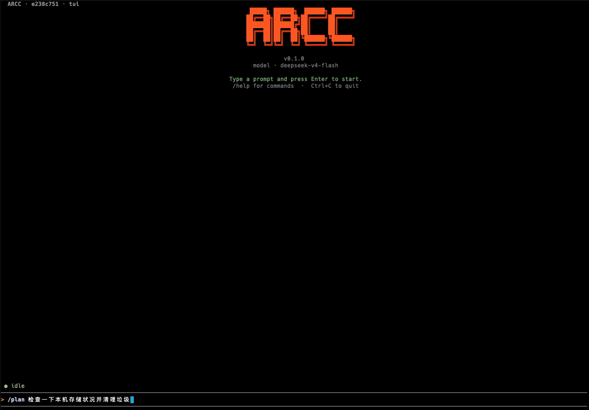

# ARCC

**[ARCC](https://juejin.cn/post/7650384140925812751) (A Rust Copilot CLI)** — a local-first terminal AI agent written in Rust. Runs as TUI, CLI, Server, or ACP stdio, speaks MCP & ACP, and is powered by DeepSeek-V4 through a provider-agnostic model layer.  
轻量高性能的 Rust 终端 AI Agent，支持 CLI、TUI、Server、ACP 四种运行模式。

[](https://www.rust-lang.org)
[](https://deepseek.com)
[](https://modelcontextprotocol.io)
[](https://github.com/nicepkg/acp)
[](https://github.com/niyongsheng/arcc/actions/workflows/ci.yml)
[](https://github.com/niyongsheng/arcc/releases)



## Features

- **🤖 Dual-Model Scheduling** — DeepSeek-V4-Pro for complex reasoning, DeepSeek-V4-Flash for routine chat; context auto-compressed at ~800k tokens.
- **🔌 MCP & ACP** — Native MCP client for plugin tools; ACP v1 stdio server (`arcc --acp`) for GUI agents like AionUI.
- **🌐 Web Search, Fetch & OCR** — DeepSeek Search / Fetch APIs (`web_search`, `web_fetch`) and document OCR (`ocr`, PDF/Word/PPT/images). Optional server-side `deepseek_web_search` / `deepseek_read_url` for the flash model. Configure via `[web]`.
- **💬 IM Bots** — Feishu and DingTalk robot integration in server mode: per-chat sessions, long-term memory, scheduled tasks, and proactive replies.
- **🛡️ Safety Engine** — Command allowlist → risk rating → interactive confirmation (y/a/n) for dangerous operations.
- **🖥️ Computer Use (macOS, TUI)** — Screen capture + mouse/keyboard control via DeepSeek Flash vision. Off by default; enable with `/computer on`; every input action is confirmed (y/a/n) and written to the audit log.
- **💾 Local-First Persistence** — SQLite for sessions/messages/tokens, JSON Lines for audit logs, TOML for config. No cloud, no telemetry.

## Running Modes

| Mode | Command | Multi-Turn | Tool Call | Persist | Pipe/Script | IM Bot |
|------|---------|:----------:|:---------:|:-------:|:-----------:|:------:|
| [**TUI**](docs/tutorial/tui-tutorial.md) | `arcc tui` | ✅ | ✅ | ✅ | — | — |
| [**CLI**](docs/tutorial/cli-tutorial.md) | `arcc cli "<prompt>"` | — | ✅ | — | ✅ | — |
| [**Server**](docs/tutorial/server-tutorial.md) | `arcc server --daemon` | ✅ | ✅ | ✅ | — | Feishu · DingTalk |
| [**ACP**](docs/tutorial/acp-tutorial.md) | `arcc --acp` | ✅ | ✅ | ✅ | — | — |

## Quick Start

You need a [DeepSeek API Key](https://platform.deepseek.com):

```bash
# Install (macOS / Linux)
curl -fsSL https://raw.githubusercontent.com/niyongsheng/arcc/main/scripts/install.sh | bash
```

```powershell
# Install (Windows PowerShell)
irm https://raw.githubusercontent.com/niyongsheng/arcc/main/scripts/install.ps1 | iex
```

```bash
# Configure
mkdir -p ~/.arcc
echo '[model]
api_key = "sk-xxxxxxxxxxxxxxxxxxxxxxxxxxxxxxxx"' > ~/.arcc/config.toml

# Start
arcc tui
```

See [config/config.toml](config/config.toml) for all options.

## Development

```bash
cargo build                    # Debug build
cargo run -- tui               # TUI mode
cargo run -- cli "<prompt>"    # CLI mode
cargo run -- server --daemon   # Server daemon
cargo run -- --acp             # ACP v1 stdio server
cargo build --release          # Release build
```

Crates: `arcc-core` (models, tools, safety, session, web) · `arcc-tui` · `arcc-cli` · `arcc-server` · `arcc-acp` · `arcc-storage`.

## License

[MIT](./LICENSE)
